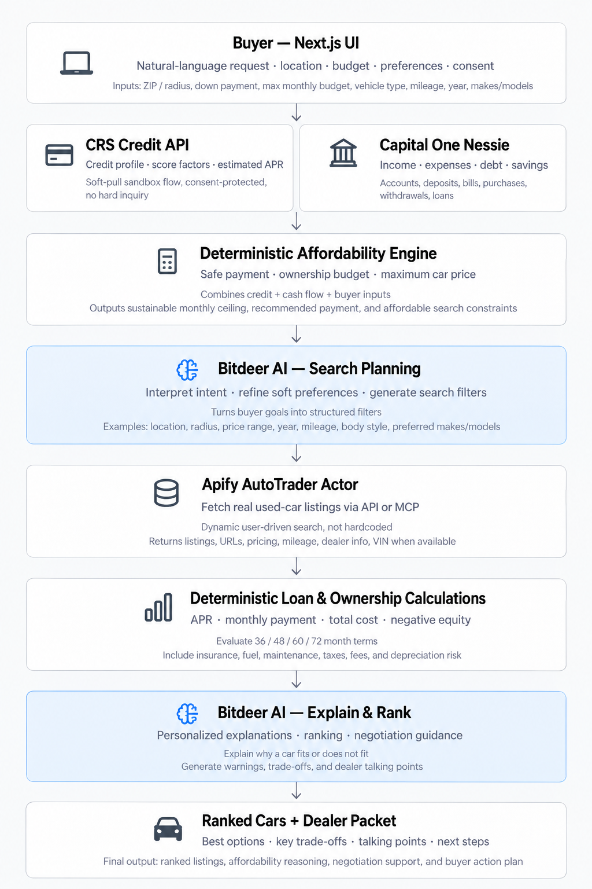

# Second Gear

Second Gear is an AI-assisted car-shopping application for first-time and subprime buyers. It combines credit context, real cash-flow data, deterministic affordability calculations, vehicle listings, and explainable recommendations so a buyer can understand what they can safely afford before visiting a dealership.

## Product workflow



### 1. Buyer - Next.js UI

The buyer enters a natural-language vehicle request, a stated monthly budget, preferences, optional down payment and ownership-cost assumptions, and consent for a soft credit pull. Consent is issued and validated server-side before the pipeline can run.

### 2. CRS Credit API

CRS supplies the credit profile used by the application:

- Credit score and score range
- Credit tier
- Tradelines and account mix
- Delinquencies, collections, charge-offs, and public records
- Revolving utilization and bureau score factors
- Inquiry data when the source can distinguish inquiry types

Second Gear derives an APR range from the score and labels it as an application estimate. It is not a lender offer, approval, or guaranteed rate. The integration supports the Experian prequalification sandbox and uses conservative validation for missing pull-type metadata.

### 3. Capital One Nessie

Nessie provides the buyer's cash-flow picture through read-only sandbox resources:

- Deposits and income
- Withdrawals and essential expenses
- Purchases and recurring bills
- Existing loans and debt obligations
- Savings balance
- Income volatility

The cash-flow analyzer uses a rolling analysis window, removes duplicate or invalid transactions, and produces the existing `AffordabilityResult` contract.

### 4. Deterministic Affordability Engine

The affordability engine combines CRS, Nessie, and buyer inputs using deterministic TypeScript functions. It distinguishes the buyer's stated budget from a sustainable amount and can recommend not purchasing a vehicle when the available cash flow is insufficient.

It produces:

- Disposable income after essential expenses and debt
- Emergency-reserve requirement
- Safe down payment
- Maximum sustainable loan payment
- Sustainable total monthly vehicle cost
- Maximum financing amount and vehicle price
- Risk indicators, warnings, assumptions, and data-quality status
- `AffordableSearchConstraints` for the listings step

Ownership costs are kept separate from the loan payment. Configurable estimates can include insurance, fuel, maintenance, registration, taxes, dealer fees, and other recurring costs.

### 5. Bitdeer AI - Search Planning

The target Bitdeer planning step interprets the buyer's request and combines soft preferences with the deterministic financial constraints to propose structured search filters for Apify.

The provider boundary is already represented in the application, but the current implementation is a deterministic mock. It must not loosen or override the affordability engine's safety limits.

### 6. Apify AutoTrader Actor

The target Apify step retrieves used-car listings using search constraints such as location, radius, price, mileage, model year, and vehicle type.

The current provider is a seeded deterministic mock so local development and tests do not require scraping credentials or live network calls. The provider interface is designed to be replaced with an Apify Actor/API or MCP-backed implementation.

### 7. Deterministic Loan & Ownership Calculations

Each candidate vehicle is evaluated with pure TypeScript calculations for 36-, 48-, 60-, and 72-month terms. Results include:

- Amount financed and estimated APR
- Monthly loan payment
- Total interest and total financing cost
- Remaining loan balance
- Estimated depreciation
- Estimated equity and negative-equity exposure
- Monthly ownership-cost breakdown
- Total monthly cost of ownership

The engine then evaluates each vehicle as `affordable`, `financially_risky`, `not_affordable`, or `insufficient_data`, with structured explanations and warnings.

### 8. Bitdeer AI  Explain & Rank

The target Bitdeer ranking step turns deterministic calculations into buyer-friendly explanations, ranks vehicles, and prepares negotiation guidance.

The current mock provider ranks the deterministic results and generates:

- Ranked cars
- Recommendation headlines and explanations
- A savings highlight
- A dealer packet with payment targets, down-payment guidance, and negotiation tips

### 9. Ranked Cars + Dealer Packet

The final result gives the buyer a shortlist, the financial reasoning behind each recommendation, dealership talking points, and practical next steps. Deterministic affordability checks remain authoritative even when future AI providers are added.

## Current provider status

| Component | Current status |
| --- | --- |
| CRS Credit API | Implemented with mock and controlled sandbox-live modes |
| Capital One Nessie | Implemented with mock and sandbox-live modes |
| Affordability Engine | Implemented as deterministic TypeScript calculations |
| Apify listings | Seeded deterministic mock; live Actor/API is a future integration |
| Bitdeer AI | Deterministic mock provider; live AI integration is a future integration |

## Getting started

Requirements: Node.js 20 and npm.

```bash
npm install
cp .env.example .env.local
npm run dev
```

Open [http://localhost:3000](http://localhost:3000).

For local development, keep the provider modes in `.env.local` set to mock:

```dotenv
CRS_MODE=mock
NESSIE_MODE=mock
CONSENT_STORE=memory
RATE_LIMIT_MODE=memory
```

Never use a real SSN, credit credential, API token, or customer identifier in source code or a `NEXT_PUBLIC_*` variable. `.env.local` is server-only and must not be committed.

## API flow

### `POST /api/consent`

Issues a short-lived, server-signed consent token after the buyer authorizes the current soft-pull consent text. Production tokens are session-bound and single-use through Upstash Redis.

### `POST /api/pipeline`

Accepts the buyer need and a valid consent token, then runs the provider pipeline:

```json
{
  "need": {
    "description": "reliable compact SUV for commuting",
    "monthlyBudget": 400,
    "zipCode": "32801"
  },
  "consentToken": "server-issued-token"
}
```

The response preserves the existing credit and cash-flow outputs and adds reusable affordability results:

```json
{
  "credit": {},
  "affordability": {},
  "affordabilityAssessment": {},
  "searchConstraints": {},
  "listings": [],
  "rankedCars": [],
  "dealerPacket": {},
  "savingsHighlight": {}
}
```

Sensitive source data such as SSNs, credentials, raw credit reports, account numbers, and request IDs is never returned to the browser.

## Production security configuration

Production must use shared Upstash-backed security controls:

```dotenv
CONSENT_STORE=upstash
UPSTASH_REDIS_REST_URL=...
UPSTASH_REDIS_REST_TOKEN=...
CONSENT_SIGNING_SECRET=at-least-32-byte-secret
APP_ORIGIN=https://your-demo.vercel.app
```

Public Vercel deployments should use mock credit mode and keep live pulls disabled:

```dotenv
CRS_MODE=mock
CRS_LIVE_PULLS_ENABLED=false
```

Restricted live CRS operation additionally requires server-only `CRS_LIVE_ACCESS_TOKEN`, `CRS_MODE=live`, and explicit live-pull enablement. Do not place live credentials in `NEXT_PUBLIC_*` variables or browser code.

The application uses session-bound consent, HMAC signing, expiration and version checks, atomic Redis replay protection, distributed rate limits, a global CRS pull quota, and an emergency kill switch. Required Redis or security configuration failures fail closed before CRS or Nessie is called.

## Development and validation

```bash
npm test
npm run lint
npx tsc --noEmit
npx next build --webpack
```

Tests use synthetic or seeded mock data. They must not make live CRS or Nessie requests unless a separate, explicitly approved sandbox validation is being performed.

## Repository structure

| Path | Purpose |
| --- | --- |
| `src/app/start/` | Buyer intake, consent, and results UI |
| `src/app/api/consent/` | Consent token endpoint |
| `src/app/api/pipeline/` | Provider and calculation pipeline |
| `src/lib/crs/` | CRS client, auth, mapping, and validation |
| `src/lib/nessie/` | Nessie client and cash-flow analysis |
| `src/lib/affordability/` | Deterministic affordability engine |
| `src/lib/calculations.ts` | Loan and vehicle calculations |
| `src/lib/providers/apify.ts` | Listings provider boundary and mock |
| `src/lib/providers/bitdeer.ts` | Ranking/explanation provider boundary and mock |
| `docs/` | Sandbox and integration documentation |

## Financial assumptions and limitations

- APR ranges are application-generated estimates, not financing offers.
- Ownership costs use configurable assumptions when buyer or vehicle-specific values are unavailable.
- The affordability engine can return no-purchase guidance instead of forcing a minimum payment or vehicle recommendation.
- CRS and Nessie demo personas are independent simulated identities; they must not be represented as one verified customer.
- The Apify and Bitdeer providers are currently mocks and are not evidence of live listing or AI availability.
- Turbopack builds can be blocked by restricted deployment environments; the webpack production build is the supported validation path for this repository.

## Roadmap

- Connect Bitdeer search planning to the `AffordableSearchConstraints` contract.
- Replace the seeded listings provider with the Apify AutoTrader Actor/API or MCP integration.
- Connect Bitdeer ranking and explanations while preserving deterministic affordability gates.
- Add richer vehicle-specific ownership-cost inputs and frontend explanations.
- Expand dealer-packet guidance with verified listing and financing data.
